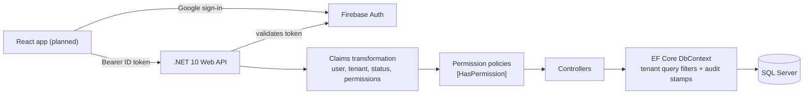

# PlantFlow

Multi-tenant operations platform for ready-mix concrete companies: orders, pricing, dispatch, delivery tracking and management dashboards.

> **Status: in active development.** The foundation (tenancy, authentication, permissions, audit, CI) is done and tested. Master data, orders and dispatch are next. See [Roadmap](#roadmap).

PlantFlow is an independent portfolio project, designed from the public domain knowledge in [`docs/domain-spec.md`](docs/domain-spec-v3.md). All data is synthetic.

## What it does

Ready-mix concrete is perishable, so operations run on tight timing: an order becomes several deliveries, each needing a batching plant, a transit mixer and a driver, and a truck that waits too long on site is a loss. PlantFlow models that whole flow for companies with several plants:

- Orders with pricing, approval stages and status history
- Delivery and batch planning, with double-booking prevention
- Live delivery tracking from batching to pour
- Quarterly volume targets against billed volume
- Returns, quality control and customer volume ledger

## What is built so far

| Area                                                                                                 | Status  |
| ---------------------------------------------------------------------------------------------------- | ------- |
| Multi-tenancy: shared database, `TenantId` on every tenant-owned row, EF Core global query filters   | Done    |
| Google sign-in with Firebase, API validates Firebase ID tokens                                       | Done    |
| New users start `Pending`; a platform admin assigns them to a company, a company admin approves them | Done    |
| Roles and permissions: 11 default roles, 37 permission keys, per-user grants and denies              | Done    |
| Audit log for every user, role and permission change                                                 | Done    |
| Integration tests proving tenant isolation and the permission gate, run against a real SQL Server    | Done    |
| CI on every push and pull request                                                                    | Done    |
| Master data, mix designs, prices, orders, dispatch, tracking, dashboards                             | Planned |
| React + TypeScript frontend                                                                          | Planned |

## Architecture



Decisions worth knowing about:

- **Tenant isolation is enforced in one place.** Every tenant-owned entity implements `ITenantOwned`, and a global query filter limits every query to the signed-in user's company. A user with no company sees nothing. Controllers don't repeat tenant checks.
- **The API is the source of truth for access.** Roles and permissions are loaded from the database on each request through a claims transformation, cached for 60 seconds and cleared the moment an admin changes anything. A disabled user loses access immediately.
- **Deny beats grant.** Effective permissions are the role's permissions, plus the user's own grants, minus the user's explicit denies.
- **Admins can't lock themselves out.** Changes to your own status, roles or permissions are rejected.
- **Volume is stored in CFT.** Display units are a tenant setting, never a storage format.
- **Guid v7 keys.** Time-ordered ids keep indexes friendly. Tenant foreign keys use `Restrict` to avoid SQL Server multiple-cascade-path errors.

## Tech stack

.NET 10 · ASP.NET Core Web API · EF Core 10 · SQL Server 2022 · Firebase Authentication · xUnit · Testcontainers · Docker · GitHub Actions

Planned: React, TypeScript, Vite, Tailwind CSS, TanStack Query.

## Run it locally

You need the [.NET 10 SDK](https://dotnet.microsoft.com/download), Docker Desktop and a free [Firebase](https://console.firebase.google.com) project with Google sign-in enabled.

**1. Start SQL Server**

Create a `.env` file in the repo root (it is git-ignored):

```
SA_PASSWORD=choose-a-strong-password
```

```bash
docker compose up -d
```

**2. Configure the API**

Secrets stay out of the repo, in .NET user secrets:

```bash
cd src/PlantFlow.Api
dotnet user-secrets set "ConnectionStrings:Default" "Server=localhost,1433;Database=PlantFlow;User Id=sa;Password=<your SA_PASSWORD>;TrustServerCertificate=True"
dotnet user-secrets set "Firebase:ProjectId" "<your Firebase project id>"
dotnet user-secrets set "Bootstrap:PlatformAdminEmail" "<the Google account that becomes platform admin>"
cd ../..
```

**3. Create the database and run**

```bash
dotnet ef database update --project src/PlantFlow.Api --startup-project src/PlantFlow.Api
dotnet run --project src/PlantFlow.Api
```

In Development the API also seeds a demo company ("Demo Ready-Mix Co.").

**4. Try it**

Sign in with Google to get an ID token, then call the API with `Authorization: Bearer <token>`. The account from `Bootstrap:PlatformAdminEmail` becomes the platform admin on its first call.

| Endpoint                                                     | Who                | Purpose                                                    |
| ------------------------------------------------------------ | ------------------ | ---------------------------------------------------------- |
| `GET /health`                                                | anyone             | health check                                               |
| `GET /api/me`                                                | any signed-in user | profile, status, company, permissions                      |
| `GET/POST /api/platform/tenants`                             | platform admin     | list and create companies                                  |
| `GET /api/platform/users/unassigned`                         | platform admin     | users waiting for a company                                |
| `POST /api/platform/users/{id}/assign`                       | platform admin     | assign a user to a company (optionally as its first admin) |
| `GET /api/users`, `POST /api/users/{id}/approve` and similar | `users.manage`     | approve, reject, disable, set roles and permissions        |
| `GET /api/roles`, `GET /api/permissions`                     | `users.manage`     | list roles and permission keys                             |
| `GET /api/audit`                                             | `audit.view`       | recent audit entries                                       |

## Tests

```bash
dotnet test
```

Integration tests start a throwaway SQL Server container (Docker must be running), apply the real migrations and run the real API with a stand-in for Firebase sign-in. They prove that:

- one company cannot read, change or see the audit entries of another company
- roles cannot be borrowed across companies
- anonymous, pending, role-less and disabled users are blocked where they should be
- an explicit deny beats a role's permission, immediately
- admins cannot change their own account

## Roadmap

1. **Master data:** plants and batching plants, customers and sites, vehicles and drivers, products, materials, service charges
2. **Mix designs and prices:** versioned recipes with approval, price master with validity and lookup at order time
3. **Orders:** BOQ lines, approval stages, confirmation, status history
4. **Dispatch and batching:** split orders into deliveries, assign plant, vehicle and driver, free-pump threshold
5. **Live tracking:** delivery status flow and a tracking board
6. **Targets and dashboards:** quarterly volume targets against billed volume
7. **Depth:** site surveys, costing and margin, order closing and billing, returns and QC

Later: real-time updates (SignalR), driver mobile app with GPS, notifications, invoicing, material stock, exports, Bangla/English.

## Author

Sabbir Ahmed · full-stack engineer · [GitHub](https://github.com/S-a-b-b-i-R) · [LinkedIn](https://linkedin.com/in/s-a-b-b-i-r-ahmed) · hiresabbirahmed@gmail.com
