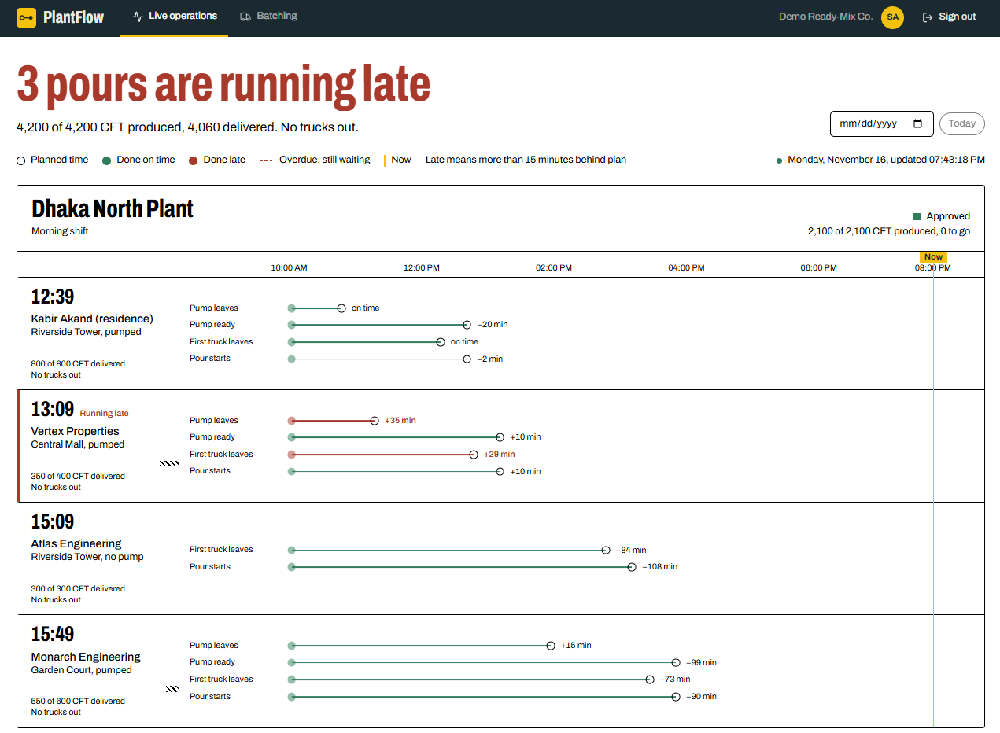
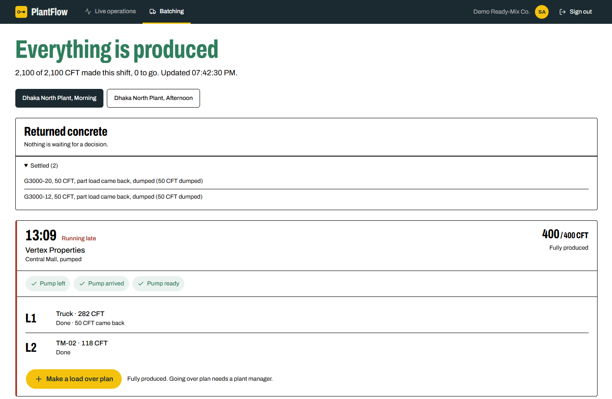
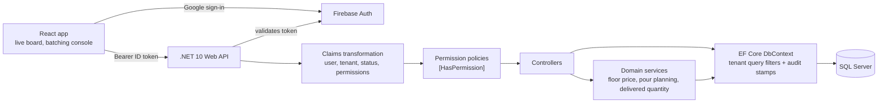

# PlantFlow

Multi-tenant operations platform for ready-mix concrete companies: orders, pricing, shift planning, batching and dispatch, returns and quality control, and live dashboards.

> **Status: in active development.** The API covers the full flow from master data to billing, and the React app already runs the plant floor: a live operations board, a batching console, the quality screen, the orders area (create, approve, confirm, bill) and the pricing area (recipes, costs, selling prices, their approvals, the cost and margin report and the pricing rules). Shift planning and administration screens are next. See [Roadmap](#roadmap).

PlantFlow is an independent portfolio project, designed from public domain knowledge in [`docs/domain-spec-v4.md`](docs/domain-spec-v4.md). All data is synthetic.



## What it does

Ready-mix concrete is perishable, so operations run on tight timing. An order becomes several pours, each needing a pump, a crew and a stream of transit mixers, and every minute a truck waits on site is a loss. PlantFlow models that flow for companies with several plants:

- **Orders and pricing:** order lines, a floor price calculated from mix design, material cost and delivery distance, approval stages, confirmation, status history and billing
- **Shift planning:** each plant plans a shift as a set of pours, with pumps and crews, and the plant manager approves the plan as a whole
- **Batching and dispatch:** trucks are loaded, sent out and followed from the plant to the pour and back
- **Returns and quality control:** concrete that comes back or is rejected is inspected, then reused, treated or dumped, and the order's billed quantity follows
- **Live dashboards:** planned time against actual time for every step of every pour, with late pours flagged

## The plant floor

The live board shows each pour as a row of steps (pump leaves, pump ready, first truck leaves, pour starts). A ring marks the planned time, a dot marks when it happened, and the line between them turns red when it is late. A step that has not happened yet runs a dashed line up to the Now marker.

The batching console is built for the operator, on a tablet or a desktop. Each pour is a card, late pours come first, and the one thing to do next is the yellow button: make a load, send it out, truck arrived, pouring started, pouring ended, truck is back.



### Business rules the system enforces

- **A truck can only carry one load at a time.** It cannot take a new load until the last one is back or cancelled.
- **Load size comes from the truck.** A load is the truck's capacity, or the company's default if the truck has none. The last load is only what is left. A smaller load needs a reason.
- **Going over the planned quantity needs a plant manager** and a written reason.
- **Pouring cannot start until the pump is ready.** A pumped pour's trucks can arrive early, but they wait.
- **Billing follows what was poured.** The delivered quantity is what was poured, less what came back, plus any returned concrete dumped through the customer's fault. Accounts resolve differences against the ordered quantity.
- **Returned concrete is reused carefully.** It can only go into a new load of the same product, at the same plant, in the same shift. Dumped concrete follows the fault: the customer pays for their own, the company absorbs its own.
- **A rejected load at the plant is always the company's fault.** A rejection at the site needs the arrival recorded and a fault chosen.
- **Leftover concrete must be recorded within a window** after pouring ends (120 minutes by default, set per company). After that only a plant manager can record it, and the audit log marks it as late.
- **Lateness is a company setting.** A step is late when it is more than a set number of minutes behind plan (15 by default).

## What is built so far

| Area                                                                                                 | Status  |
| ---------------------------------------------------------------------------------------------------- | ------- |
| Multi-tenancy: shared database, `TenantId` on every tenant-owned row, EF Core global query filters   | Done    |
| Google sign-in with Firebase, API validates Firebase ID tokens                                       | Done    |
| New users start `Pending`; a platform admin assigns them to a company, a company admin approves them | Done    |
| Roles and permissions: 11 default roles, 39 permission keys, per-user grants and denies              | Done    |
| Audit log for user, role, permission, order, production and returns changes                          | Done    |
| Master data: plants and shifts, customers and sites, vehicles and drivers, products, materials       | Done    |
| Mix designs with approval, material and overhead costs, price master, floor price and margin         | Done    |
| Orders: lines, charges, VAT options, approval stages, confirmation, hold, closing and billing        | Done    |
| Site surveys with photos, shift plans with pumps and crews, plan approval                            | Done    |
| Production and dispatch: loads, truck and pump steps, delivered quantity from poured loads           | Done    |
| Returns and QC: part returns, rejects, inspection, treatment, dumping, reuse, billing adjustments    | Done    |
| Dashboards: live operations, production and delivery, orders and billing                             | Done    |
| React app: sign-in and approval flow, live operations board, batching console                        | Done    |
| React screens: quality control, orders, approvals, confirmation and billing                          | Done    |
| React screens: pricing (recipes, costs, selling prices, approvals)                                   | Done    |
| Users assigned to the plants they work for, with a Users screen to choose them                       | Done    |
| React screens: shift planning and administration                                                     | Planned |
| Quarterly volume targets, customer volume ledger                                                     | Planned |

## Architecture



Decisions worth knowing about:

- **Tenant isolation is enforced in one place.** Every tenant-owned entity implements `ITenantOwned`, and a global query filter limits every query to the signed-in user's company. A user with no company sees nothing, and another company's ids return 404. Controllers don't repeat tenant checks.
- **The API is the source of truth for access.** Roles and permissions are loaded from the database on each request through a claims transformation, cached for 60 seconds and cleared the moment an admin changes anything. A disabled user loses access immediately. The web app only hides what the API would refuse anyway.
- **Deny beats grant.** Effective permissions are the role's permissions, plus the user's own grants, minus the user's explicit denies.
- **Admins can't lock themselves out.** Changes to your own status, roles or permissions are rejected.
- **Billing logic lives in one service.** `DeliveredQuantity` is the single place that turns loads and returns into a billed quantity, so a change to the rules cannot leave two code paths disagreeing.
- **Times are stored in UTC and shown in plant time.** Shifts and pours are planned in the plant's local time, and each company sets its offset.
- **Volume is stored in CFT.** Display units are a tenant setting, never a storage format.
- **Guid v7 keys.** Time-ordered ids keep indexes friendly. Tenant foreign keys use `Restrict` to avoid SQL Server multiple-cascade-path errors.
- **The web app has no CORS setup.** In development a Vite proxy forwards `/api` to the API, so the browser sees one origin.

## Tech stack

**API:** .NET 10 · ASP.NET Core Web API · EF Core 10 · SQL Server 2022 · Firebase Authentication · xUnit · Testcontainers · Docker · GitHub Actions

**Web:** React 19 · TypeScript · Vite · Tailwind CSS 4 · shadcn/ui · TanStack Query · React Router · Firebase JS SDK

## Run it locally

You need the [.NET 10 SDK](https://dotnet.microsoft.com/download), [Node.js](https://nodejs.org) 22 or newer, Docker Desktop and a free [Firebase](https://console.firebase.google.com) project with Google sign-in enabled.

**1. Start SQL Server**

Create a `.env` file in the repo root (it is git-ignored):

```
SA_PASSWORD=choose-a-strong-password
```

```bash
docker compose up -d
```

**2. Configure the API**

Secrets stay out of the repo, in .NET user secrets:

```bash
cd src/PlantFlow.Api
dotnet user-secrets set "ConnectionStrings:Default" "Server=localhost,1433;Database=PlantFlow;User Id=sa;Password=<your SA_PASSWORD>;TrustServerCertificate=True"
dotnet user-secrets set "Firebase:ProjectId" "<your Firebase project id>"
dotnet user-secrets set "Bootstrap:PlatformAdminEmail" "<the Google account that becomes platform admin>"
cd ../..
```

**3. Create the database and run the API**

```bash
dotnet ef database update --project src/PlantFlow.Api --startup-project src/PlantFlow.Api
dotnet run --project src/PlantFlow.Api --launch-profile http
```

In Development the API seeds a demo company ("Demo Ready-Mix Co.") with three plants, shifts, mixers and pumps, products, customers and sites. It also builds a live operating day at Dhaka North around the current time, so the dashboards have something to show: a pour running well, one running late, and two still ahead. Restarting does not duplicate it.

**4. Run the web app**

In `web/`, copy `.env.example` to `.env.local` and fill in the Firebase web app settings (API key, auth domain, project id, app id), then:

```bash
cd web
npm install
npm run dev
```

Open http://localhost:5173 and sign in with Google. In Development, the API moves the account from `Bootstrap:PlatformAdminEmail` into the demo company as its admin when it starts, so sign in once, restart the API, and reload. The live board and the batching console then open with the demo data.

## API at a glance

| Area              | Examples                                                                                                            |
| ----------------- | ------------------------------------------------------------------------------------------------------------------- |
| Identity          | `GET /api/me`, `GET/POST /api/platform/tenants`, `POST /api/platform/users/{id}/assign`, `/api/users`, `/api/roles` |
| Master data       | `/api/plants`, `/api/customers`, `/api/sites`, `/api/vehicles`, `/api/drivers`, `/api/products`, `/api/materials`   |
| Pricing and costs | `/api/mix-designs`, `/api/prices`, floor price and margin endpoints                                                 |
| Orders            | `/api/orders` and the approval, confirmation, hold, close and billing actions                                       |
| Planning          | `/api/site-surveys`, `/api/shift-plans`, pour planning with pump and crew checks                                    |
| Production        | `GET /api/shift-plans/{id}/operator`, `POST /api/pours/{id}/loads`, `POST /api/loads/{id}/dispatch`, `.../steps`    |
| Returns and QC    | `POST /api/loads/{id}/reject`, `.../part-return`, `POST /api/returns/{id}/decide`                                   |
| Dashboards        | `GET /api/dashboards/live`, `/production`, `/orders`                                                                |

Every endpoint is behind a permission (`[HasPermission]`). In Development the OpenAPI document is served by the API.

## Tests

```bash
dotnet test
```

Integration tests start a throwaway SQL Server container (Docker must be running), apply the real migrations and run the real API with a stand-in for Firebase sign-in. There are more than 160 of them. They prove that:

- one company cannot read, change or see the audit entries of another company
- roles cannot be borrowed across companies
- anonymous, pending, role-less and disabled users are blocked where they should be
- an explicit deny beats a role's permission, immediately
- admins cannot change their own account
- orders, approvals, pricing and billing follow their rules
- production follows its rules: truck capacity, one load per truck, the pump ready before pouring, over-plan overrides
- returns, rejects and reuse net out correctly into the billed quantity
- dashboards add up and show nothing across companies
  CI runs the .NET build and tests on every push and pull request. A second workflow lints and builds the web app when `web/` changes.

## Roadmap

1. **Shift planning screens in the web app**
2. **Administration screens:** assigning users to companies, roles and permissions (assigning users to plants is done)
3. **Targets and ledger:** quarterly volume targets against billed volume, customer volume ledger
4. **Web tests:** component tests for the console and the board
5. **Deployment:** a hosted demo
   Later: real-time updates (SignalR) instead of polling, a driver mobile app with GPS, notifications, invoicing, material stock, exports, Bangla and English.

## Author

Sabbir Ahmed · full-stack engineer · [GitHub](https://github.com/S-a-b-b-i-R) · [LinkedIn](https://linkedin.com/in/s-a-b-b-i-r-ahmed) · hiresabbirahmed@gmail.com
